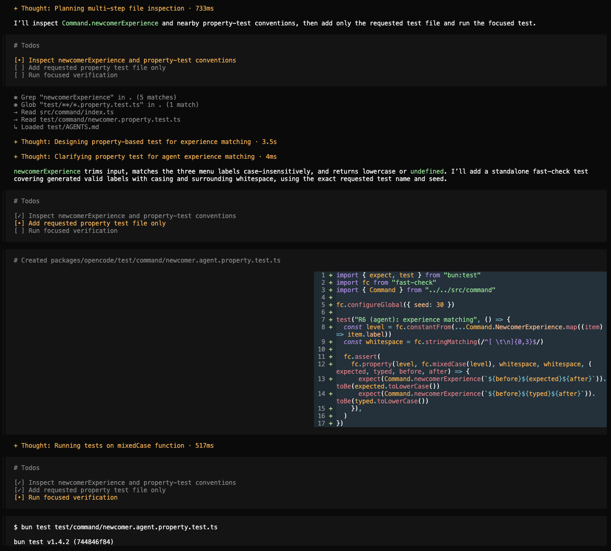
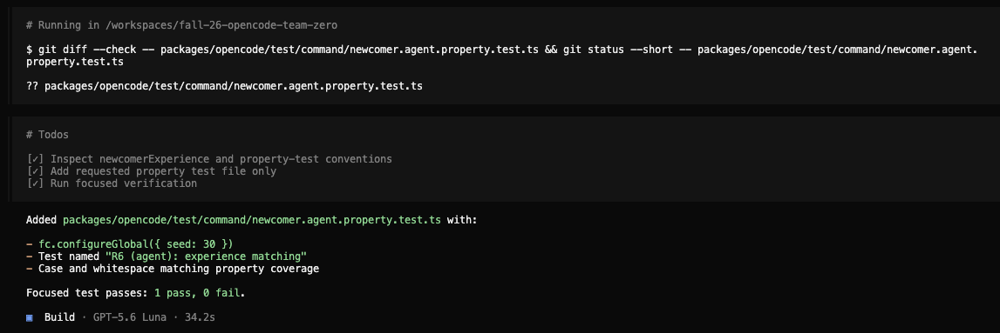

# Traceability: Jay Yip (jayy)

**Target feature:** /newcomer command feature that provides guided paths to newcomers to a codebase. It lives in 

- https://github.com/CMU-313/fall-26-opencode-team-zero/blob/38733a62faf4efa2ee17aa70a929b0e432c09abc/packages/opencode/src/command/template/newcomer.txt
- https://github.com/CMU-313/fall-26-opencode-team-zero/blob/38733a62faf4efa2ee17aa70a929b0e432c09abc/packages/opencode/src/command/index.ts
- https://github.com/CMU-313/fall-26-opencode-team-zero/blob/38733a62faf4efa2ee17aa70a929b0e432c09abc/packages/opencode/src/session/prompt.ts
- https://github.com/CMU-313/fall-26-opencode-team-zero/blob/38733a62faf4efa2ee17aa70a929b0e432c09abc/packages/opencode/test/effect/runner.test.ts

## Requirements

| ID | Interview evidence | Requirement | Acceptance Criteria | Changed in P4? | Property (kind) | Test | Mutants it kills |
|---|---|---|---|---|---|---|---|
| R1 | C-2, S-4, O-4: “Something that should never happen is my feature misleading the user.” | The /newcomer command must only recommend files and directories that exist in the codebase. | If the command recommends for example src/index.ts, that file must exist in the current codebase. | No | Invariant | packages/opencode/test/command/newcomer.property.test.ts:40 | H2, RT2 (Leo) |
| R2 | C-4, S-5: “With minimal experience, it should incrementally understand the codebase” | The command should provide simple explanations and terminology for beginner developers. | When a beginner runs the /newcomer command, the output uses simple explanations and introduces important files without overwhelming technical details | Yes | N/A | N/A | None |
| R3 | C-5, C-6: “I would also hope to see greater technical terminology (and thus more specific details).” | The command should provide more technical details to more experienced developers. | When an advanced developer runs the /newcomer command, the output includes more specific information about the codebase’s architecture and functions. | Yes | N/A | N/A | None |
| R4 | C-3, S-3: “It should always be a table and then should have relatively same output on two same runs” | The command should produce consistently formatted results when given the same inputs. | Running /newcomer twice with the same developer level and codebase produces tables with similar structure and generally similar recommendations, including the same major entry points. | Yes | Model/Oracle | packages/opencode/test/command/newcomer.property.test.ts:50 | H1 |
| R5 | C-7, S-6, O-7: “In a smaller codebase, the modules should be broken down more in-depth and more specific | The command should adjust the level of detail based on the size of the codebase. | When run on a small codebase, the command highlights specific files and functions. On a large codebase, however, it provides a broader overview of major directories and modules. | Yes | N/A | N/A | None |
| R6 | C-11, C-12: “You can provide quick summaries on the difference you should expect” | The command should explain what each developer level offers before the user makes a selection | When the developer level selection appears, each option includes a short description explaining what kind of guidance the user will receive. | No | Invariant | packages/opencode/test/command/newcomer.property.test.ts:66, packages/opencode/test/command/newcomer.property.test.ts:79 | H3, H5, RT1 (Leo) |
| R7 | O-9: “One thing I would change about my feature is moving from overview to each different module more clearly”  | The command should clearly guide users from the general project overview to individual modules.  | After presenting the project overview, the command identifies major modules and explains where the user should begin exploring each one. | No | Metamorphic | packages/opencode/test/command/newcomer.property.test.ts:97 | H4, RT3 (Leo) |

Properties written or suggested by opencode or another AI tool: Codex (for fc generation ideas)

## Requirement changes

| ID | Original requirement (P3) | Revised requirement | Why it changed |
|---|---|---|---|
| R2 | The command should provide simple explanations and terminology for beginner developers. | The command should provide a project overview and plain-language descriptions of important files for beginner developers. | The original requirement was subjective because "simple explanations" is difficult to measure. The revision identifies specific information beginners should receive. | 
| R3 | The command should provide more technical details to more experienced developers. | The command should provide architecture information and more detailed code explanations for experienced developers. | The original requirement did not specify what technical details should be included. The revision identifies expected content that can be checked. | 
| R4 | The command should produce consistently formatted results when given the same inputs. | The command should maintain the same table structure across runs with the same inputs. | Since /newcomer uses an LLM, identical recommendations cannot be guaranteed. The revision focuses on consistent formatting rather than identical content. | 
| R5 | The command should adjust the level of detail based on the size of the codebase. | The command should focus on individual files for smaller codebases and major modules for larger ones. | The original requirement did not specify how the output should change. The revision clarifies the expected difference between smaller and larger codebases. |

## Hand-written mutants

| ID | Requirement targeted | Change | Predicted killer | Actual result |
|---|---|---|---|---|
| H1 | R4 | `newcomer.txt`: drop the `Run from` column from the Development setup table | "Keeps the same table layout each time" (R4) | Killed: the generator picked the Development setup section and the missing column failed the check |
| H2 | R1 | `newcomer.txt`: "cite real repository paths" weakened to "cite repository paths" | "Recommends only paths that are really in the project" (R1) | Killed: the generated rule was no longer in the prompt |
| H3 | R6 | `command/index.ts`: Beginner description cut to "Plain language" (2 words, one below the 3-word minimum) | "Explains every experience choice" (R6) | Killed: the description fell below the word-count boundary |
| H4 | R7 | `newcomer.txt`: "Where to start" moved above "Major components" | "Moves from the overview to places to start" (R7) | Killed: the section-order check failed |
| H5 | R6 | `command/index.ts`: level match changed from `===` to `startsWith`, so an empty argument matches "beginner" and the level menu is skipped | None (R6 only reads the option text) | Survived: no property runs the command, so a skipped menu goes unnoticed (killed after strengthening, see below) |

## Stryker comparison

- fast-check seed: 30
- Initial mutation score: 50% (10 of 20 mutants killed, 10 survived). All 10 mutants in the `NewcomerExperience` options list in `command/index.ts` were killed by the R6 property. All 10 mutants in the experience-matching code in `session/prompt.ts` (lines 1387-1388) survived, because no property executed that code.

**1) Which of your hand-written mutants did Stryker never generate? Why not?**
- H1, H2, and H4 edited `newcomer.txt`, the prompt template that R1, R4, and R7 depend on. Stryker only mutates JavaScript/TypeScript source, so it never generated any mutants in this text file, even though it holds most of the feature's behavior.
- H3 shortened the Beginner description to two words, one below the three-word minimum the R6 property checks. Stryker's string mutator only replaced the description with an empty string, so it never tested that boundary. Both versions were killed, but only H3 showed the property enforced the exact minimum.
- H5 changed the experience match from `===` to `startsWith`, so an empty argument matched "beginner" and skipped the level menu. Stryker has no operator that swaps one string comparison for another. Its closest mutant, `find((item) => true)`, also skipped the menu, but for every input rather than only an empty one, which made it a cruder version of the same bug.

**2) Which Stryker survivors would you never have thought of? Are any of them bugs a real developer might plausibly write?**
- Removing `.trim()` from the user's input was something I never would have thought of. It was a plausible bug, since a developer cleaning up the code could have dropped it as redundant. Without it, `/newcomer " advanced"` with a stray space would no longer match and would show the menu again.
- Replacing one level name with an empty string (for example `["beginner", "", "advanced"]`) was also plausible as a typo or a bad copy and paste. `/newcomer intermediate` would then have silently stopped skipping the menu, and nothing in the UI would have flagged it.
- Changing `toLowerCase()` to `toUpperCase()` was another slip I wouldn't have considered. It would have made every typed level fail to match, since the list stores lowercase names.
- The remaining survivors, such as emptying the whole list, replacing the predicate with `true` or `false`, or flipping `===` to `!==`, were mechanical changes a real developer would rarely write. They still mattered, because together they showed that none of my properties ran the matching logic at all.

**3) What does each approach find that the other doesn't?**
- My hand-written mutants were driven by the requirements, so they reached the prompt template that Stryker couldn't mutate (H1, H2, H4) and tested meaningful edge cases, like H3's word-count boundary. They also modeled realistic bugs, like H5's lenient match, that Stryker's fixed set of operators never produces.
- Stryker applied every operator to every expression in the scoped lines without any bias toward what I expected to break. That made it much better at finding gaps in code I assumed was fine: it produced 10 surviving variations of the matching logic, while my hand-written mutants caught that gap only once, with H5.
- Both approaches pointed to the same weakness. My properties checked static artifacts, such as the prompt text and the options list, but never exercised how the command handled what the user actually typed. That was the clearest place to strengthen them next.

## Strengthening

- I moved the experience-matching logic out of `session/prompt.ts` into an exported `Command.newcomerExperience()` function in `command/index.ts`, so a property could call it directly instead of the code being buried inside the session runner.
- I added a new R6 property, "shows the experience menu unless a real level was typed" (`newcomer.property.test.ts:79`). Its generators produce each level with random casing (`fc.mixedCase`) and random leading and trailing whitespace, and check that it matches the correct lowercase level. A second generator produces arbitrary strings, including empty and whitespace-only input, and checks that anything that isn't a level returns no match, so the menu is shown.
- This killed all 10 Stryker survivors: the casing mutants (`toUpperCase`) and the `.trim()` removal failed on mixed-case and padded input, the blanked level names and empty list failed when a real level stopped matching, and the always-true, always-false, and `!==` predicates failed one of the two checks. It also killed hand-written mutant H5, since an empty argument now has to show the menu instead of matching "beginner".
- No example-based tests were added; every survivor was killed by strengthening a property.
- Final mutation score (seed 30): 100% as reported by Stryker (21 of 21 mutants killed), and 100% with equivalent mutants excluded, since there were none.
- Equivalent mutants: I claimed no mutants as equivalent. Each of the 10 original survivors changed what `newcomerExperience()` returned for at least one input, such as padded text, mixed-case text, a specific level name, or an empty argument. Since the strengthened R6 property generated those inputs and all 21 mutants were killed, none of them could be equivalent, so there were no equivalent mutants to argue for or exclude.

## Agent failure case

- Transcript excerpt: 
    - Prompt: Add a quick fast-check property test for Command.newcomerExperience in packages/opencode/src/command/index.ts. Put it in a new file packages/opencode/test/command/newcomer.agent.property.test.ts (import { Command } from "../../src/command"), add fc.configureGlobal({ seed: 30 }), and name it "R6 (agent): experience matching". Don't change other files.
    - Response:  
- Surviving mutant: H5 (`mutants/jayy/H5.patch`), which changed the experience match in `Command.newcomerExperience()` from `item === requested` to `item.startsWith(requested)`. Since every string starts with the empty string, running `/newcomer` with no argument matched "beginner" and silently skipped the experience menu, breaking R6. Against only the agent's test (seed 30), H5 passed with 1 pass, 0 fail.
- Why the property was too weak: opencode's generators only produced valid level names (with random casing and whitespace), so the property only checked the happy path where the user typed a real level. It never generated empty, whitespace-only, or non-level input, so it never checked that those return `undefined` and show the menu. This was a generator that never reached the bug, since `startsWith` still matched every valid level correctly.
- Strengthened version and evidence: I added a second assertion that generated arbitrary, empty, and whitespace-only strings (`fc.oneof(whitespace, fc.string())`), skipped real levels (`fc.pre`), and expected `undefined`. The strengthened test passed on the real code (1 pass, 0 fail) and failed with H5 applied (1 fail), with the counterexample `[""]`, exactly the empty-argument case that skipped the menu. See below for the strengthened version's code, followed by the terminal output showing it passing on the real code and killing H5 (I pasted the terminal output below).

```ts
// Strengthened: anything that is not a real level, including empty input, must not skip the menu.
fc.assert(
  fc.property(fc.oneof(whitespace, fc.string()), (typed) => {
    fc.pre(!Command.NewcomerExperience.some((item) => item.label.toLowerCase() === typed.trim().toLowerCase()))
    expect(Command.newcomerExperience(typed)).toBeUndefined()
  }),
)
```

```text
$ bun test test/command/newcomer.agent.property.test.ts        # real code
 1 pass
 0 fail
 300 expect() calls

$ git apply mutants/jayy/H5.patch
$ bun test test/command/newcomer.agent.property.test.ts        # with H5 applied
error: Property failed after 1 tests
{ seed: 30, path: "0:0", endOnFailure: true }
Counterexample: [""]
(fail) R6 (agent): experience matching
 0 pass
 1 fail
```


## Red team

Received from Leo Liu (xinruil3, Team seg-fault) on PR #41, written against commit `92a15fe`. Since the code had moved after that commit, I re-applied each change at its current location before running my properties.

| ID | Requirement targeted | Change | Result before | Fix | Result after |
|---|---|---|---|---|---|
| RT1 | R6 | Experience match changed from `===` to `startsWith`, so an empty argument matched "beginner" and skipped the level menu | Killed: same bug as my H5, already caught by the strengthened R6 property (counterexample `[""]`) | None needed | Killed |
| RT2 | R1 | `newcomer.txt`: "use `Not found` when a category does not exist" replaced with "fill every row with the most likely path for that category" | Survived: the R1 property only checked three other safeguard phrases | Added "use `Not found` when a category does not exist" to the R1 generator of required safeguards | Killed |
| RT3 | R7 | `newcomer.txt`: `All areas` sections presented "in whatever order best fits the project" | Survived: the R7 property only checked heading positions in the template, not wording that lets the model reorder them | Added a check to the R7 property that the template never contains reordering wording ("whatever order", "any order", "reorder", "different order") | Killed |
