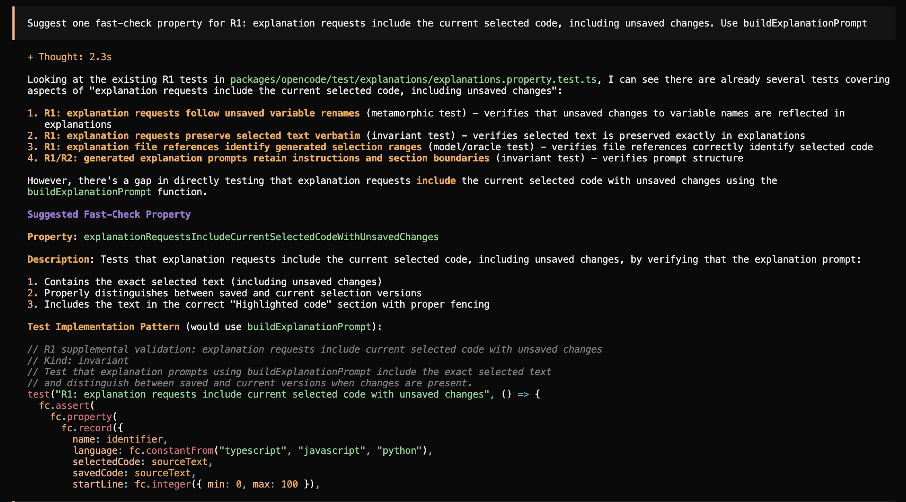
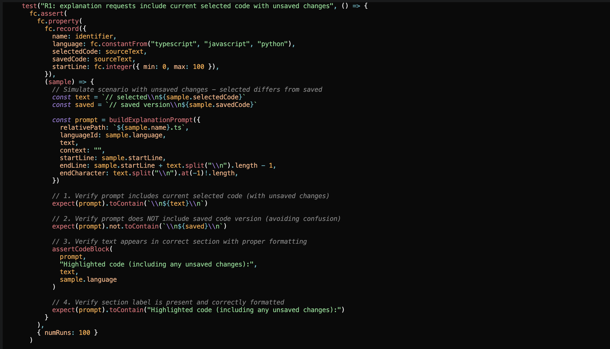

# Traceability: Janna Lu jannaanl

**Target feature:** Generating code suggestions and explanations commands, and the main source files it lives in

[`sdks/vscode/src/explain.ts`](https://github.com/CMU-313/fall-26-opencode-team-zero/blob/main/sdks/vscode/src/test/explain.test.ts)

[`sdks/vscode/src/extension.ts`](https://github.com/CMU-313/fall-26-opencode-team-zero/blob/main/sdks/vscode/src/extension.ts)

[`sdks/vscode/src/test/explain.test.ts`](https://github.com/CMU-313/fall-26-opencode-team-zero/blob/main/sdks/vscode/src/test/explain.test.ts)

[`sdks/vscode/src/test/explain.e2e.test.ts`](https://github.com/CMU-313/fall-26-opencode-team-zero/blob/main/sdks/vscode/src/test/explain.e2e.test.ts)

[`sdks/vscode/src/test/explain.integration.test.ts`](https://github.com/CMU-313/fall-26-opencode-team-zero/blob/main/sdks/vscode/src/test/explain.integration.test.ts)

## Requirements

| ID | Interview evidence | Requirement | Acceptance Criteria | Changed in P4? | Property (kind) | Test | Mutant it kills
|---|---|---|---|---|---|---|---|
| R1 | C-4: "I would expect everything to be the same except for the variable name which would be changed to the new name.” S-4: “It [ Claude ] should give the same explanation as to how the code works, and should only change the referenced variable with the new name. “ | Explanations should accurately reflect the current version of the user’s code. | If a user renames a variable without changing the code’s behavior, the explanation should use the updated name but describe the same functionality. |Yes| Metamorphic| `explanations.property.test.ts`: “R1: explanation requests follow unsaved variable renames”; “R1: explanation requests preserve selected text verbatim”| H5 |
| R2 | S-1: “I put the whole file in so it could get all the context of previous functions”| Code explanations and suggestions should use relevant code as context. | If a selected function calls another function defined earlier in the same file, the explanation should describe the called function’s behavior. |No|Invariant|`explanations.property.test.ts`: “R2: explanation requests include earlier called function definitions”| H2 |
| R3 | C-2: “It should never .. change files I didn't ask it to change.” S-2: “It should only change what is visible and highlight the changes.” | Code suggestions should only suggest code based on where the user’s cursor is/what file the user’s on. | Given two open files, with the cursor in file A, requesting a code suggestion produces an edit for file A at the cursor location or within the selected code. No proposed edits target file B.|No|Invariant|`suggestions.property.test.ts`: “R3: suggestion requests identify the active file and exact cursor context” — partial coverage| H1, H3 |
| R4 | S-6: “I would run the new code against tests, and if the new code is right then the tests should pass.”  O-5: “And run the code against written tests.” | Code suggestions should be tested and checked before being suggested in the output. | If a project has existing automated tests, the extension checks suggested code against the tests before outputting it. |Yes|Oracle|---|---|
| R5 | S-3: “CoPilot shouldn’t change any code without my permission. Only make changes when I approve it.”| Should not make any changes to the codebase.| All project files should remain unchanged. |No|Invariant|`suggestions.property.test.ts`: “R5: explanation and suggestion requests leave project files unchanged” — request-stage coverage| H4 |


Properties written or suggested by opencode or another AI tool: None

## Requirement changes

| ID | Original requirement (P3) | Revised requirement | Why it changed |
|---|---|---|---|
| R1 | Explanations should accurately reflect the current version of the user’s code. | When a user requests an explanation, the extension includes the currently selected code, including unsaved changes, in the explanation request. | The original wording was too broad and subjective to test reliably. The revision defines an observable behavior with clear pass/fail criteria. |
| R2 | Code explanations and suggestions should use relevant code as context. | The explanation request includes the selected code and the definitions of functions it calls that are declared earlier in the same file. | "Relevant code" is too subjective and checking whether the output correctly describes a called function also requires a defined expected answer. |
| R4 | Code suggestions should be tested and checked before being suggested in the output. | If a project has existing automated tests, the extension provides users with a way to run those tests after applying a code suggestion and displays whether the tests pass or fail. | Testing the original requirement would require applying suggestions and running existing tests in a temporary environment. The revision makes user-triggered testing and its results observable. |

## Hand written mutants

| ID | Requirement Targeted | Change | Predicted Killer | Actual Result |
|---|---|---|---|---|
| H1 | R3 |`sdks/vscode/src/explain.ts`, `buildCodeSuggestionPrompt`: change `${input.cursorLine + 1}` to `${input.cursorLine}` in the file reference. |“Suggestion requests identify the active file and exact cursor context” (R3)|Killed(✗ R3: suggestion requests identify the active file and exact cursor context)|
| H2 |R2|`sdks/vscode/src/extension.ts`: In the explanation command, change the context range’s starting line from `0` to `Math.max(0, selection.start.line - 30)`, omitting earlier code beyond 30 lines.|“Explanation requests include earlier called function definitions” (R2)|Killed (✗ R2: explanation requests include earlier called function definitions)|
| H3 |R3 |`sdks/vscode/src/extension.ts`: In the suggestion command’s endLine calculation, change `document.lineCount - 1` to `document.lineCount - 2`, excluding the document’s final line.|“Suggestion requests identify the active file and exact cursor context” (R3)|Killed (✗ R3: suggestion requests identify the active file and exact cursor context)|
| H4 |R5| `sdks/vscode/src/extension.ts`: In the explanation command, append `"\n"` to the active file using a filesystem operation before sending the request, modifying the file without approval.|“Explanation and suggestion requests leave project files unchanged” (R5)|Killed (✗ R5: explanation and suggestion requests leave project files unchanged)|
| H5 |R1|`sdks/vscode/src/explain.ts`: In `buildExplanationPrompt`, replace the highlighted-code entry `input.text` with `input.text.trim()`, removing selected leading and trailing whitespace.|“Explanation requests preserve selected text verbatim” (R1)|Killed (✗ R1: explanation requests preserve selected text verbatim )|

## Stryker Comparison
My initial mutation score was 52.11% (37 out of 71 mutants killed, 34 survived). File `sdks/vscode/src/explain.ts` killed 22 mutants and had 25 survive and `sdks/vscode/src/extension.ts` killed 15 mutants and had 9 survive. 

#### Which of your hand-written mutants did Stryker never generate? Why not?
- Stryker did not generate mutants for H2, H4, or H5. H2 limited the explanation context to only read the past 30 lines. This requires inserting a new Math.max expression and a context limit. Stryker’s generated mutations did not check for this behavior.vH4 adds a newline to the active file. This requires adding a filesystem operation, but Stryker did not check file-writing behavior. H5 trims the selected text to make sure that all of the selected test is sent to the prompt. This requires inserting a `.trim()` call, which Stryker did not generate. 
- Stryker generated related mutations for H1 and H3. H1 modifies the cursor's file reference by removing +1, but Stryker generated -1. VS Code counts lines starting at 0, but the file reference counts them starting at 1. The original + 1 converts between those systems. My mutant removes the conversion, while Stryker’s mutant reverses the arithmetic operation. Both mutants produce the incorrect cursor line location. 
- H3 changes `document.lineCount - 1` to `document.lineCount - 2`, while Stryker produced `document.lineCount + 1`. document.lineCount is the number of lines, but VS Code’s line indexes start at 0. H3 excludes the final line, while Stryker's mutant allows a line beyond the end of the file. 

#### Which Stryker survivors would you never have thought of? Are any of them bugs a real developer might plausibly write?
The Stryker survivors showed gaps around explanation locations, invalid editor states, startup behavior, and failed requests.
- Removing the explanation's file name/location was something I would not have thought of. R1 checks that the selected code is included, and R2 checks earlier function definitions, but neither checks the explanation’s file reference. R3 checks file references only for suggestions. This is plausible bug since someone could accidentally remove file information while simplifying the prompt in the opencode terminal.
- Identifying only the starting line number instead of the exact range for a selected block of code is also something I didn't think of. Stryker `const range = lines.start === lines.end ? #L${lines.start} : #L${lines.start}-${lines.end}` to `const range = true ? #L${lines.start} : #L${lines.start}-${lines.end}` in `sdks/vscode/src/explain.ts`. This is a plausible bug because a developer could only check for singe line selections and miss multiline selections. 
- Hiding an error when an explanation request fails was also something I did not think of. Stryker replaced the error handler in `sdks/vscode/src/extension.ts` with `.catch(async (error) => {})`. My properties missed this because the test server always returns successful responses. This is a plausible bug because a developer could leave an empty error handler while debugging, causing requests to fail without telling the user what went wrong.
- Removing instructions about beginner-friendly language and explanation length was something I had not included in my mutants. My properties check code, context, cursor information, and file preservation, but they do not check these instructions. This is a plausible mistake when simplifying a prompt. However, it does not necessarily violate the requirements my current properties cover.

#### What does each approach find that the other doesn't?
- My hand-written mutants targeted specific mistakes related to my requirements, such as limiting earlier context to 30 lines, trimming the selected text, and modifying a file without permission. Stryker did not generate those exact changes because they required adding or changing behavior beyond the mutations it produced.
- Stryker explored conditions, strings, and blocks I had not targeted manually. Its 34 survivors included removing the explanation’s file reference, always displaying only the starting line, and emptying the error handler. These exposed specific gaps in R1 and R2, which check the explanation’s code and context but not its location. My tests always simulate successful requests, so they never check whether an error message appears when a request fails.

## Stryker Strengthening
- I strengthened the properties in `explanations.property.test.ts` and `suggestions.property.test.ts`. The new generators cover single-line and multiline selections, empty and nonempty context, failed requests, missing editors/workspaces, and fresh terminal startup. 
- I added an R1 property that generates different code selections and checks that the explanation request includes the correct file name and line numbers. It also checks selections that end at the start of the next line, so that extra line is not counted. This caught mutants that removed the file reference or showed only one line number for a selection of multiple lines.
- I added a property that simulates different errors when sending or submitting a prompt. It checks that the extension tells the user what failed and includes the error code. This caught mutants that hid the error or displayed an empty message.
- I added tests for when no file or workspace is open. They check that the extension shows a helpful message instead of sending a request. I also added an R5 property that opens a new terminal and checks that it starts in read-only plan mode. This caught a mutant that removed the plan-mode setting, which the earlier tests missed because they always reused an existing terminal.
- To catch the remaining mutants, I added properties that check the instructions and formatting in explanation and suggestion requests. They check that requests still include teaching instructions, tell the AI not to change files, and keep sections separated correctly. This caught mutants that deleted instructions or inserted unwanted text. These checks cover more details than my original acceptance criteria.
- No example-based tests were added. All five hand-written mutants remained killed, and the Stryker score increased from 52.11% (37/71) to 100% (71/71). All 11 properties and the package typecheck passed.
- I did not classify any mutants as equivalent because they changed the request text or the extension’s behavior. My original tests missed those changes, but the stronger tests caught them. Since none were excluded as equivalent, the adjusted mutation score is also 100%.

## Agent Failure Case
- Prompt: "Suggest one fast-check property for R1: explanation requests include the current selected code, including unsaved changes. Use buildExplanationPrompt"
- Output: 


The property was saved in `mutants/jannaanl/A1.patch`
- Survived Mutant: H5 (`mutants/jannaanl/H5.patch`) which changed `input.text` to `input.text.trim()`. This removed leading and trailing whitespace from the selected code, violating R1’s requirement to preserve the selected code exactly. The property “explanation requests follow unsaved variable renames” still passed with H5 applied.

```
jannalu@jannas-mbp-6 opencode % bun test test/explanations/explanations.property.test.ts -t "^R1:"                                                                         
bun test v1.4.4 (38afee6c8)

test/explanations/explanations.property.test.ts:
✓ R1: explanation requests follow unsaved variable renames [767.30ms]
 1 pass
 5 filtered out
 3 fail
 1419 expect() calls
Ran 4 tests across 1 file. 
```
- Why it was weak: The property generated variable renames, but its selected code had no leading or trailing whitespace. Calling `.trim()` therefore left the generated selections unchanged, so the property could not detect H5. It checked whether updated variable names were included, but did not generate the whitespace boundaries needed to check exact preservation.
- Strengthened version: I added generators for leading and trailing whitespaces (`fc.constantFrom(" ", "\t", "\n", " \t\n"),
fc.constantFrom(" ", "\t", "\n", "\n \t")`) and put the whitespace around every generated selection (`const text = ${leading}// selected ${name}\n${code}${trailing}`). Then I checked that the code block preserves the selection exactly (`expect(block).toBe(${opening}\n${text}\n${fence}`).

After applying the strengthened property and running it against H5:

``` 
% bun test test/explanations/explanations.property.test.ts -t "R1: explanation requests preserve selected text verbatim"

test/explanations/explanations.property.test.ts:
✓ R1: explanation requests preserve selected text verbatim [321.01ms]

 1 pass
 8 filtered out
 0 fail
 1232 expect() calls
```

```
% git apply mutants/jannaanl/H5.patch

% bun test test/explanations/explanations.property.test.ts -t "R1: explanation requests preserve selected text verbatim"

✗ R1: explanation requests preserve selected text verbatim [10.91ms]

 0 pass
 8 filtered out
 1 fail
 12 expect() calls
 ```